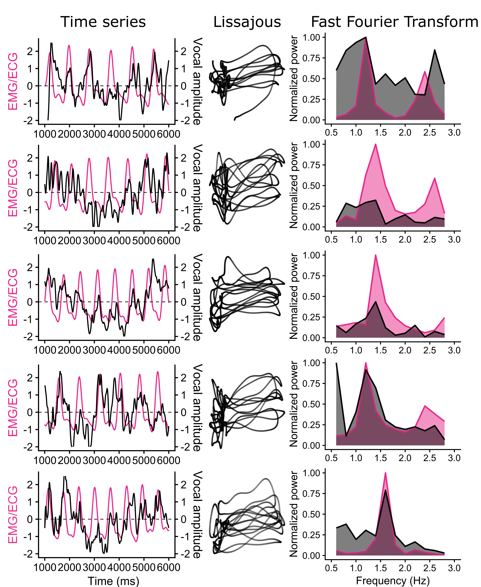

# Discriminating mechanisms of heart-voice coupling
This repository contains the code and data links to reproduce the results of the current publication "Discriminating mechanisms of heart-voice coupling" published in JASA.

## Computationally reproducicable notebook
View our analysis quarto notebook online: [https://wimpouw.github.io/VoiceAndHeart/heartrate_expire](https://wimpouw.github.io/VoiceAndHeart/heartrate.html)

  
   
  <em>Figure 2 of the paper.</em>

## Current publication related to this dataset
* Hafkamp, M. S. J., Werner, R., Drijvers, L., Selen, L. P. J., Pouw, W. (2026). Discriminating mechanisms of heart-voice coupling. *The Journal of the Acoustical Society of America*. doi: 10.1121/10.0047650

## Open Data (already published)
Access the complete large data files at the Radboud Data Repository
* DOI: https://doi.org/10.34973/p9se-mq71
* Location: https://data.ru.nl/collections/di/dcc/DSC_2023.00002_259

## Other associated publications of this dataset
* Pouw, W., Werner, R., Burchardt, L. S., & Selen, L. P. (2025). The human voice aligns with whole-body kinetics. Proceedings B, 292(2047), 20250160. [https://doi.org/10.1098/rspb.2025.0160](https://doi.org/10.1098/rspb.2025.0160).
* Pouw, W., Burchardt, L. S., Werner, R. J., & Selen, L. P. J. (2024). Movement-related muscle activity and kinetics affect human vocalization amplitude. In *Proceedings of the International Conference on the Evolution of Language (EVOLANG2024)*, Madison, USA.
* Werner, R., Selen, L., & Pouw, W. (2024). Arm movements increase acoustic markers of expiratory flow. In *Proceedings of Speech Prosody 2024*, Leiden, The Netherlands.

## Contact
For questions or collaborations, please contact: m.hafkamp@tilburguniversity.edu, w.pouw@tilbuguniversity.edu or go to www.wimpouw.com
